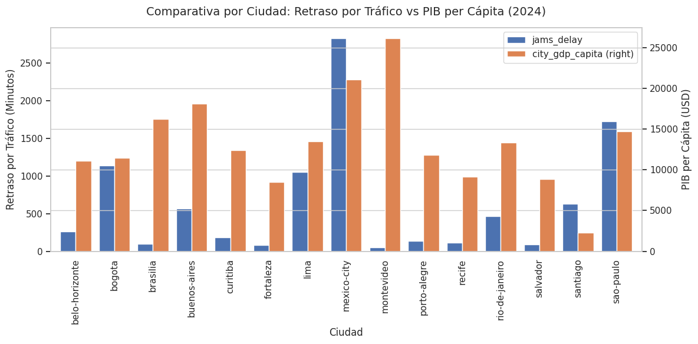
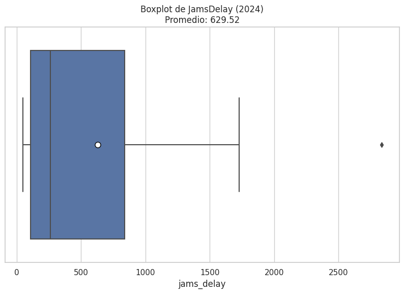
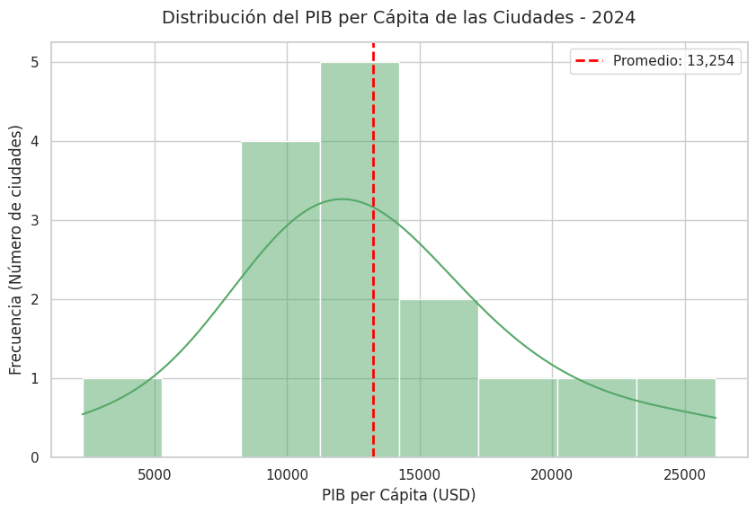

# 🚦 Movilidad urbana y productividad económica en LATAM

Integración y análisis de datos de tráfico y de economía urbana para 15 ciudades de América Latina en 2024. El objetivo es entender si la congestión vial se relaciona con la productividad económica e identificar ciudades prioritarias para invertir en transporte.


> **Nota:** proyecto del Bootcamp de Análisis de Datos de TripleTen (2026), planteado como un encargo para un banco de desarrollo. Los datos se basan en el TomTom Traffic Index y en OECD Cities, en versiones proporcionadas por el bootcamp.



---

## 📌 Resumen en 30 segundos

- **No hay una relación lineal directa** entre el PIB per cápita y la congestión: una ciudad rica no está condenada al tráfico, ni una ciudad de menor ingreso tiene calles fluidas.
- **Ciudad de México y São Paulo** combinan economías fuertes con la congestión más alta: su densidad superó la capacidad vial.
- **Montevideo y Brasilia** tienen el PIB per cápita más alto de la muestra con un retraso casi nulo: son los modelos a estudiar.
- Un grupo de ciudades de ingreso moderado sufre una congestión desproporcionada para su nivel económico.

---

## ❓ Preguntas de negocio

1. ¿Qué ciudades presentan alta congestión y baja productividad económica?
2. ¿Cuáles combinan movilidad eficiente y economía fuerte?
3. ¿Qué variables parecen tener una relación más fuerte con el desarrollo urbano?

---

## 🗂️ Datos

| Fuente | Contenido | Granularidad |
|--------|-----------|--------------|
| `tomtom_traffic.csv` | Índices de congestión, tiempos de viaje y minutos perdidos en atascos (`jams_delay`) | Miles de registros continuos por ciudad |
| `oecd_city_economy.csv` | PIB per cápita, desempleo, población y calidad del aire (PM2.5) | Un registro anual por ciudad |

---

## 🔍 Metodología

1. **Limpieza y estandarización:** nombres de columnas en `snake_case`, fechas a `datetime` y limpieza de columnas numéricas guardadas como texto (separadores de miles, comas decimales y símbolos de porcentaje en `city_gdp_capita`, `unemployment_pct`, `population_m` y `pm25`).
2. **Filtro temporal:** análisis enfocado en 2024.
3. **Agregación:** promedio anual de las métricas de tráfico por ciudad para igualar la granularidad con los datos económicos.
4. **Integración:** unión interna (*inner join*) por `city` y `year`, que conserva solo las ciudades con información completa en ambas fuentes.
5. **Análisis exploratorio:** boxplots, histogramas y gráfico comparativo de doble eje por ciudad.

---

## 📊 Resultados clave

| Distribución del retraso por tráfico | Distribución del PIB per cápita |
|---|---|
|  |  |

- Retraso promedio por congestión: **629.5 minutos al año** por ciudad, con un valor atípico muy por encima del resto.
- PIB per cápita promedio: **$13,254 USD**.
- Se identifican tres perfiles de ciudad:

| Perfil | Ejemplos | Lectura |
|--------|----------|---------|
| Economía fuerte y congestión alta | Ciudad de México, São Paulo | La densidad superó la infraestructura vial |
| Economía fuerte y congestión baja | Montevideo, Brasilia | Modelos de éxito en planeación urbana |
| Ingreso moderado y congestión alta | Varias ciudades intermedias | Prioridad para inversión en transporte |

---

## 💡 Recomendaciones

1. **Estudiar los modelos de Montevideo y Brasilia:** planeación urbana, horarios de restricción de carga y densidad de transporte público.
2. **Diseñar planes de mitigación de bajo costo y alto impacto** a partir de esas prácticas, para aplicarlos en las ciudades más congestionadas.
3. **Validar las fuentes y ampliar el periodo** antes de decisiones de inversión: con 15 ciudades y un solo año, las conclusiones son exploratorias.

---

## 📁 Estructura del repositorio

```
├── notebooks/
│   └── movilidad_urbana_productividad.ipynb   # Análisis completo
├── images/                                    # Gráficas usadas en este README
├── requirements.txt
└── README.md
```

## ▶️ Cómo ejecutarlo

```bash
git clone https://github.com/gaby27lop-jpg/movilidad-urbana-latam.git
cd movilidad-urbana-latam
pip install -r requirements.txt
jupyter notebook notebooks/movilidad_urbana_productividad.ipynb
```

Los datasets fueron proporcionados por la plataforma del bootcamp y no se incluyen en el repositorio. El notebook conserva todas las salidas, así que el análisis completo se puede revisar directamente en GitHub.

---

## 👩‍💻 Autora

**Gabriela López Larios**, Analista de Datos

[LinkedIn](https://www.linkedin.com/in/gabrielalopezlarios) · [GitHub](https://github.com/gaby27lop-jpg)
